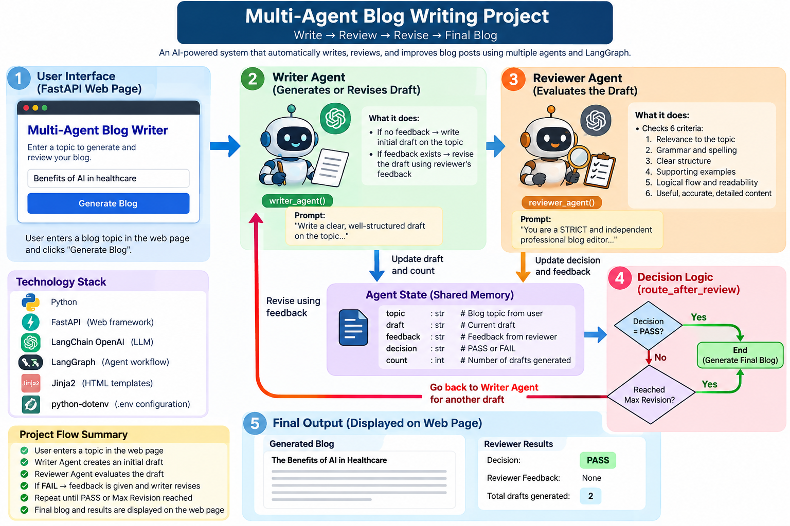
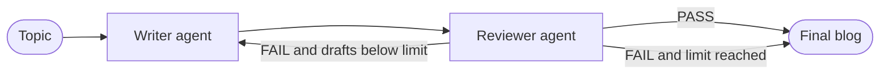
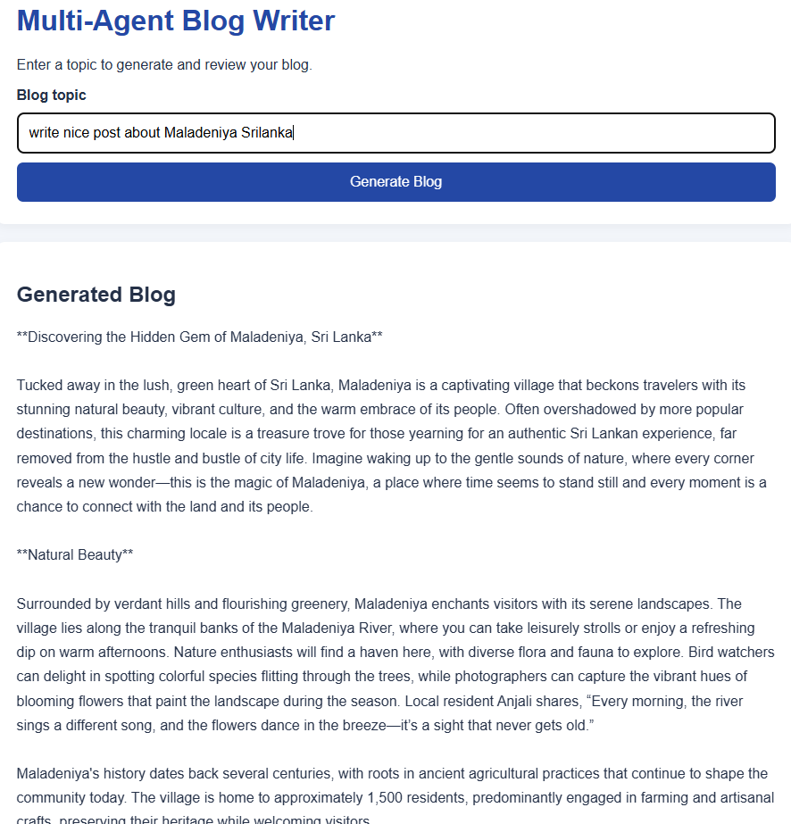

# Multi-Agent Blog Writer

**Write → Review → Revise → Final Blog**

An AI-powered web app where two AI agents work together to write a blog post. A **Writer** agent drafts the post, a strict **Reviewer** agent checks it, and the draft goes back and forth between them until it passes review or hits a revision limit. The loop is built with [LangGraph](https://github.com/langchain-ai/langgraph), and the web page is served by [FastAPI](https://fastapi.tiangolo.com/).



---

## Table of contents

- [How it works](#how-it-works)
- [Tech stack](#tech-stack)
- [Project structure](#project-structure)
- [Getting started](#getting-started)
- [Configuration](#configuration)
- [Usage](#usage)
- [Customizing the agents](#customizing-the-agents)
- [Troubleshooting](#troubleshooting)
- [Contributing](#contributing)
- [License](#license)

---

## How it works

1. **You enter a topic** on the web page and click **Generate Blog**.
2. **Writer agent** (`writer_agent`) writes a first draft on the topic.
3. **Reviewer agent** (`reviewer_agent`) checks the draft against six criteria:
   1. Relevance to the topic
   2. Grammar and spelling
   3. Clear introduction, body, and conclusion
   4. Supporting examples or evidence
   5. Logical structure and readability
   6. Useful, accurate, sufficiently detailed content

   It returns a **decision** (`PASS` or `FAIL`) and **feedback** for the writer.
4. **Decision logic** (`route_after_review`) chooses what happens next:
   - `PASS` → stop, the blog is done.
   - `FAIL` and the revision limit is not reached → send the draft and feedback back to the writer.
   - `FAIL` but the revision limit is reached → stop and show the latest draft.
5. **The final blog**, the reviewer's decision and feedback, and the number of drafts are shown on the web page.



### Shared state

Both agents read from and write to one shared state object (`AgentState`). LangGraph passes it between the steps.

| Field      | Type  | Meaning                                 |
|------------|-------|-----------------------------------------|
| `topic`    | `str` | The blog topic entered by the user      |
| `draft`    | `str` | The current draft from the writer       |
| `feedback` | `str` | The reviewer's feedback on the draft    |
| `decision` | `str` | `PASS` or `FAIL` from the reviewer      |
| `count`    | `int` | How many drafts the writer has produced |

---

## Tech stack

| Tool                                                       | Used for                                      |
|------------------------------------------------------------|-----------------------------------------------|
| Python                                                     | Language                                      |
| [LangGraph](https://github.com/langchain-ai/langgraph)     | Builds the Writer ⇄ Reviewer loop as a graph |
| [LangChain OpenAI](https://python.langchain.com/)          | Calls the OpenAI chat model                   |
| [FastAPI](https://fastapi.tiangolo.com/) + Uvicorn         | Web server                                    |
| Jinja2                                                     | HTML template for the web page                |
| python-dotenv                                              | Loads settings from a `.env` file             |

---

## Project structure

```
MultiAgent_Loop/
├── backend.py          # Agents, LangGraph workflow, and FastAPI routes
├── templates/
│   └── index.html      # Web page (topic form + results)
├── requirement.txt     # Python dependencies
├── pyproject.toml      # Project metadata (for uv)
├── .env                # Your settings and API key (never commit this)
├── MultiAgent.png      # Architecture diagram
└── README.md
```

---

## Getting started

### Prerequisites

- **Python 3.14** (the version set in `.python-version` and `pyproject.toml`)
- An **OpenAI API key**: get one at <https://platform.openai.com/api-keys>

### 1. Clone the repository

```bash
git clone https://github.com/<your-username>/MultiAgent_Loop.git
cd MultiAgent_Loop
```

### 2. Create a virtual environment and install dependencies

**With pip:**

```bash
python -m venv .venv

# Windows
.venv\Scripts\activate
# macOS / Linux
source .venv/bin/activate

pip install -r requirement.txt
```

**Or with [uv](https://docs.astral.sh/uv/):**

```bash
uv venv
uv pip install -r requirement.txt
```

### 3. Create your `.env` file

Create a file named `.env` in the project root:

```env
OPENAI_API_KEY=sk-your-key-here
MODEL=gpt-4o-mini
Max_Revision=3
```

See [Configuration](#configuration) for what each setting does.

### 4. Run the app

```bash
uvicorn backend:app --reload
```

Open <http://127.0.0.1:8000> in your browser.

---

## Configuration

All settings live in `.env`:

| Variable         | Required | Description                                                                                         |
|------------------|----------|-----------------------------------------------------------------------------------------------------|
| `OPENAI_API_KEY` | Yes      | Your OpenAI API key                                                                                 |
| `MODEL`          | Yes      | OpenAI chat model to use, for example `gpt-4o-mini` or `gpt-4o`                                     |
| `Max_Revision`   | Yes      | Maximum number of drafts, **including the first one**. `3` means 1 first draft + up to 2 revisions |

> ⚠️ **Never commit your `.env` file.** It contains your secret API key. It is listed in `.gitignore`.

---

## Usage

1. Open <http://127.0.0.1:8000>.
2. Type a blog topic, for example `Benefits of AI in healthcare`.
3. Click **Generate Blog** and wait. Each draft and review is a separate model call, so this can take a little while.
4. Read the result:
   - **Generated Blog**: the final draft
   - **Decision**: `PASS` or `FAIL` from the reviewer
   - **Feedback**: what the reviewer wants improved, or `None`
   - **Total drafts generated**: how many times the writer ran

The terminal also prints each step (writer drafting or revising, the reviewer's raw response, and the parsed decision), so you can follow the loop live.



---

## Customizing the agents

Everything is in `backend.py`:

- **Change how the writer writes:** edit the prompts in `writer_agent`.
- **Make the reviewer stricter or easier:** edit the criteria and rules in the `reviewer_agent` prompt.
- **Change when the loop stops:** edit `route_after_review`, or change `Max_Revision` in `.env`.
- **Add another agent** (for example a fact-checker or SEO editor):
  1. Write a function that takes `AgentState` and returns a dict of the fields it changes.
  2. Register it with `builder.add_node(...)` in `build_graph()`.
  3. Connect it with `builder.add_edge(...)` or `builder.add_conditional_edges(...)`.
  4. Add any new fields it needs to `AgentState`.

---

## Troubleshooting

| Problem                                                                    | Fix                                                                                                         |
|----------------------------------------------------------------------------|-------------------------------------------------------------------------------------------------------------|
| `TypeError: int() argument must be ... not 'NoneType'`                     | `Max_Revision` is missing from `.env`.                                                                      |
| `openai.AuthenticationError`                                               | `OPENAI_API_KEY` is missing or wrong.                                                                       |
| `Form data requires "python-multipart" to be installed`                    | Run `pip install python-multipart` (it's already in `requirement.txt`).                                     |
| `TemplateNotFound: index.html`                                             | Run `uvicorn` from the project root, so the `templates/` folder can be found.                               |
| The result is always `FAIL`                                                | The reviewer is strict by design. Raise `Max_Revision`, or relax the rules in the `reviewer_agent` prompt. |

---

## Contributing

Contributions are welcome. Bug fixes, new agents, better prompts, UI improvements, and tests are all useful.

1. Fork the repository.
2. Create a branch: `git checkout -b feature/my-change`
3. Make your changes and test them locally.
4. Commit: `git commit -m "Add my change"`
5. Push: `git push origin feature/my-change`
6. Open a Pull Request that explains what you changed and why.

Found a bug or have an idea? Please open an issue.

---

## License

No license has been chosen yet. Until one is added, all rights are reserved by the author. Add a `LICENSE` file (for example [MIT](https://choosealicense.com/licenses/mit/)) to let others use, change, and share this project.

---

## Author

Built by **Dhanushka** as a learning project on multi-agent AI systems with LangGraph.
